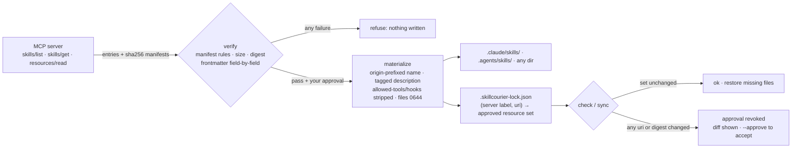

# skillcourier

**Your MCP servers already serve Agent Skills. Your agent can't load them. `skillcourier` imports them into Claude Code, Codex or any `SKILL.md` agent: each file is digest-verified, the skill is labelled with where it came from, and the approval is pinned in a lockfile and revoked if the server changes a single byte.**

[](https://github.com/Prime-agentai/skillcourier/actions/workflows/ci.yml)


The [MCP Skills extension (SEP-2640)](https://modelcontextprotocol.io/seps/2640-skills-extension) went Final on 2026-09-13. Hugging Face, Cloudflare, Salesforce, n8n, Glean, Outline, Ansible and [more](https://github.com/modelcontextprotocol/ext-skills/blob/main/docs/implementations.md) now serve skills over MCP. Claude Code, Codex, Cursor and VS Code don't consume them yet ([claude-code#106550](https://github.com/anthropics/claude-code/issues/106550)). `skillcourier` bridges that gap today, and it enforces the spec's host-side safety rules on the way in.

```console
$ skillcourier ls https://huggingface.co/mcp --label hf
hf: 25 skills (https://huggingface.co/mcp)
  hf-cli                             1 files, 33.4 KB       -> hf-hf-cli
  hf-cloud-python-env-setup          4 files, 13.0 KB       -> hf-hf-cloud-python-env-setup  [2 script files]
  huggingface-trackio                4 files, 24.8 KB       -> hf-huggingface-trackio
  train-sentence-transformers        31 files, 270.5 KB     -> hf-train-sentence-transformers  [14 script files]
  ...

$ skillcourier add https://huggingface.co/mcp --label hf huggingface-trackio train-sentence-transformers --yes
+ hf-huggingface-trackio  (4 files verified)
+ hf-train-sentence-transformers  (31 files verified)
```

*(Real output from the live Hugging Face server on 2026-11-20, trimmed.)*

## Quickstart (30 seconds)

Requires Python 3.11+ and [uv](https://docs.astral.sh/uv/) (or pipx).

```bash
# 1. See which of your configured MCP servers serve skills (reads ~/.claude.json, .mcp.json, ~/.codex/config.toml)
uvx --from git+https://github.com/Prime-agentai/skillcourier skillcourier servers

# 2. Browse and import, by configured label or by URL (no account needed for this one)
uvx --from git+https://github.com/Prime-agentai/skillcourier skillcourier add https://huggingface.co/mcp --label hf hf-mem

# 3. Start Claude Code: the skill is in /skills as hf-hf-mem, its description starting "[MCP skill from server 'hf']"
```

Keep it installed with `uv tool install git+https://github.com/Prime-agentai/skillcourier` (or `pipx install ...`).

Then keep the imports honest. Add this to `.claude/settings.json` to get a one-line warning at session start when anything drifted:

```json
{ "hooks": { "SessionStart": [ { "hooks": [ { "type": "command", "command": "skillcourier check --hook" } ] } ] } }
```

## How it works



1. **Connect.** Over stdio or Streamable HTTP. It speaks protocol `2026-07-28` (`server/discover`, per-request `_meta`, the `MCP-Protocol-Version` / `Mcp-Method` / `Mcp-Name` headers) and falls back to the legacy `initialize` handshake exactly as the base spec's backward-compatibility rules say. `skills/*` is only called on servers that declare `io.modelcontextprotocol/skills`.
2. **Validate the entry** before touching any file. The manifest must be complete, list `SKILL.md`, and name each file once. Every file must stay inside the skill directory: no `..`, encoded traversal, backslashes, drive letters, or names that collide case-insensitively. The limits are 512 files and 16 MiB. The final path segment must equal `name`.
3. **Fetch and verify every file.** Size first, then SHA-256, then `SKILL.md` frontmatter compared field by field with the entry. One failure and nothing is written, not even the target directory.
4. **Materialize with provenance.** The directory and `name` become `<label>-<name>`, so a served skill can never shadow a local one. Same-named skills on one server get their full path. The description starts with `[MCP skill from server '<label>']`. `metadata` records origin, URI and digest. `allowed-tools` and `hooks` are stripped unless you pass `--grant-tools`. The body and every supporting file stay byte-identical, and nothing is made executable. Writes are atomic (temp dir + rename).
5. **Pin.** The lockfile binds your approval to the exact `resources` set (every URI + digest) under the identity pair (server label, skill URI). It holds no header values, no env values, and no configured stdio command lines.
6. **Re-check.** `check` asks each server for its entries (no file downloads) and recomputes local digests. Any change upstream (a file rotated, added or removed, or the label pointing at a different server) revokes the approval. `sync` shows the diff and waits for `--approve`. Grants never survive a change.

## Commands

| Command | What it does |
|---|---|
| `skillcourier servers` | Configured MCP servers (Claude Code local/project/user scope, Codex), probed: era, skills yes/no, count |
| `skillcourier ls <server>` | Served skills: size, file count, install name, flags (`asks for allowed-tools+hooks`, script files, `dynamic`, same-name local skill, imported). `-l` for descriptions, `--json` |
| `skillcourier show <server> <skill> [--file F]` | Print a verified file, so you can read before you import |
| `skillcourier add <server> <skill>... \| --all` | Verify, review, approve (`--yes` or prompt) and import. `--dry-run`, `--grant-tools`, `--to` |
| `skillcourier check [--offline] [--hook] [--json]` | Exit 0 if every import matches its server and the disk; 1 if anything needs attention |
| `skillcourier sync [--approve] [--restore]` | Restore missing skills (e.g. fresh clone with a committed lockfile); show and re-approve changed ones |
| `skillcourier remove <name>...` | Delete imported skills (refuses anything it didn't import) |
| `skillcourier dev-server <dir> [--http PORT]` | Serve your own skills folder over MCP to preview what an import will look like |

`<server>` is a configured label (`hf`), a URL (`https://huggingface.co/mcp`, add `--header 'Authorization: Bearer …'` if needed), or a label plus `--cmd "<stdio command>"`. `--to` picks the target: `claude` (`./.claude/skills`, default), `claude-user` (`~/.claude/skills`), `agents` (`./.agents/skills`), `agents-user` (`~/.agents/skills`), or any directory your agent reads skills from.

**Teams:** commit `.claude/skills/.skillcourier-lock.json` alongside the imported skills. A teammate runs `skillcourier check`, and CI can run it too (exit 1 on drift). Use `sync` to restore anything missing, verified against the pinned digests.

## Spec conformance, including where this deliberately differs

| SEP-2640 host requirement | skillcourier |
|---|---|
| Call `skills/*` only after the server declares the extension | ✅ |
| Request `_meta` on every modern request; HTTP metadata headers incl. base64 `Mcp-Name` | ✅ (validated by the test server) |
| Legacy fallback only on non-modern errors; never on `UnsupportedProtocolVersion` | ✅ |
| Invalid entries (missing/odd `resources`, incomplete manifest, file outside the skill) are never loaded | ✅ shown as `INVALID` in `ls` |
| Verify size and digest of every retrieved file; frontmatter field-by-field | ✅ |
| Never read a file not in the held entry's manifest | ✅ (`directoryRead` is never used) |
| Identity is (server identity, uri); materialized path encodes the server | ✅ host-assigned label, never `serverInfo.name` |
| Disambiguate same-name entries; never silently shadow another origin | ✅ path-qualified names; refuses to overwrite unowned dirs |
| Ignore `allowed-tools` (and declarative hooks) unless the user approved the grant | ✅ stripped unless `--grant-tools`; revoked on change |
| Persisted approval bound to the full `resources` set; any change revokes it | ✅ |
| `dynamic` skills cannot be content-bound | ✅ declined (the spec allows hosts to refuse them) |
| Limits: support 512 files / 16 MiB per skill | ✅ enforced from the entry before any fetch |
| **Lazy retrieval** (no fetching ahead of need) | ⚠️ **By design, no.** `add` *is* the explicit request for the files, like fast-agent's `/skills add` or ChatGPT's import |
| **Served content cached outside filesystem-skill discovery paths** | ⚠️ **By design, no.** Making served skills discoverable by agents that only read folders is the whole point. To compensate, the origin is in the name, description and metadata, grants are stripped, and `check` recomputes local digests every run |
| Tag content with its origin server at the point it enters model context | ◑ The skill list the model sees carries the origin in name and description. The body is left byte-identical |

**Digests are not a trust anchor.** The server supplies both the content and its digest. A match proves consistency, not trustworthiness. What you are trusting is the server you chose, and `skillcourier` makes sure you keep getting exactly what you approved from it. Read script files before you run them (`show --file`). The agent's own permission prompts still apply to anything a skill asks it to execute.

## Verified so far

- `scripts/check.sh` is the single gate: `mypy --strict`, 71 pytest tests, and an end-to-end CLI scenario against the dev server over stdio (import, refusal without approval, upstream change → revoked → diff → re-approve, local tamper → detect → restore, remove).
- The tests run both transports (stdio and HTTP, JSON and SSE responses) and both protocol eras (modern and legacy), with header validation on every HTTP request. Tamper cases: wrong digest, wrong size, lying frontmatter, traversal URIs, case collisions, dynamic and malformed entries, a label re-pointed at a new server, and secrets kept out of the lockfile.
- **Live interop:** `SKILLCOURIER_LIVE=1 scripts/check.sh` imports from `https://huggingface.co/mcp` (protocol 2026-07-28, 25 skills). In development, 3 skills / 39 files were verified end to end. The other 15+ servers on the implementations list are untested here.
- CI: Ubuntu + macOS × Python 3.11 / 3.12 / 3.13, plus a uv quickstart job.

Not verified: Windows; OAuth-only servers (send a token via `headers`); servers on legacy SSE transport (unsupported).

## Roadmap

- [ ] OAuth 2.1 for HTTP servers that need it (today: static headers, `${VAR}` expanded)
- [ ] `--from-lock` bootstrap for CI without configured servers (works today for URL and `--cmd` origins)
- [ ] Policy file: allow/deny servers and skills, require `--grant-tools` review in CI
- [ ] Opt-in support for `dynamic` skills, re-verified on every `check`
- [ ] Watch mode / `skills/list` `ttlMs`-aware refresh
- [ ] Native Codex and Cursor target presets once their skills paths settle

## Development

```bash
git clone https://github.com/Prime-agentai/skillcourier && cd skillcourier
uv run --no-project --with pyyaml --with types-pyyaml --with pytest --with mypy bash scripts/check.sh
```

One runtime dependency (PyYAML), everything else is the standard library. The dev server (`skillcourier dev-server examples/skills`) is a small spec-conformant SEP-2640 server. It is handy for checking your own server's skills before you publish them.

## License

MIT. Not affiliated with Anthropic, the MCP project or any server named here. Skill contents belong to their authors. Check each skill's `license` field before redistributing an import.
